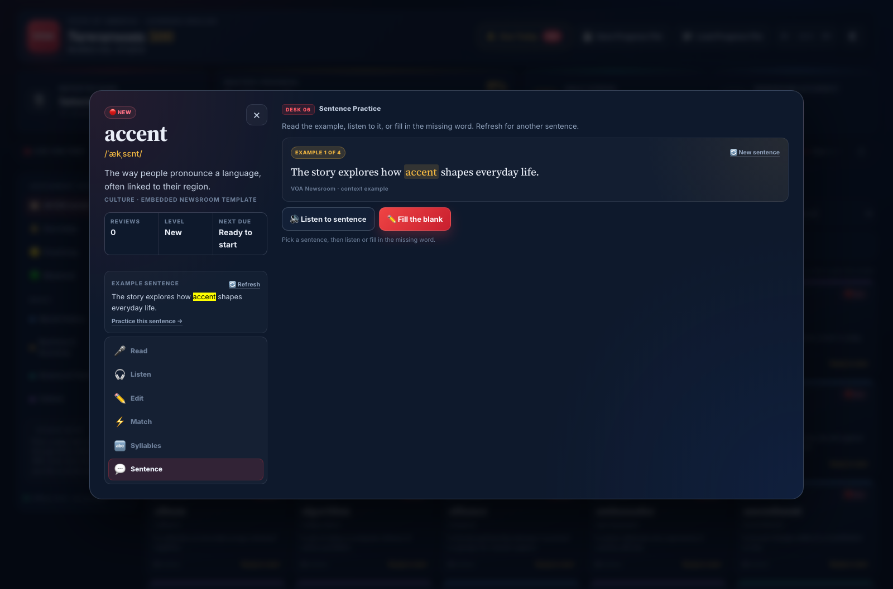
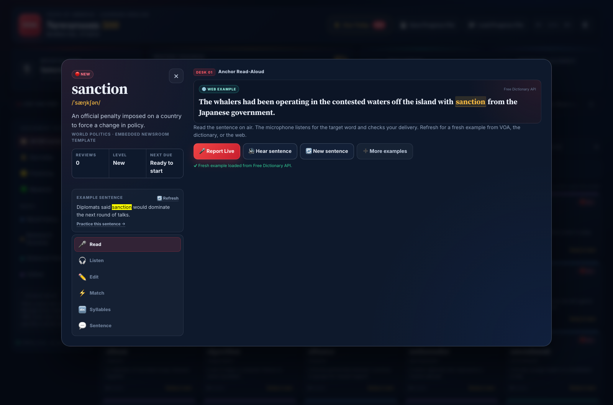

# VOA Newsroom: 500 Words ESL Studio

A production-ready, browser-native vocabulary studio for ESL learners, built around a digital newsroom. It runs entirely from a read-only static host such as GitHub Pages — no backend, no database, no build step, and no account.



**Live demo:** <https://somphol.github.io/voa-newsroom-esl-studio/>

## What it does

- **500 curated VOA-style vocabulary words** across four beats:
  - World Politics — 125 words
  - Business & Economy — 125 words
  - Science & Tech — 125 words
  - Culture — 125 words
- **Six newsroom learning desks** for every word:
  1. **Anchor Read-Aloud** — read a live VOA headline or a refreshed dictionary/Wikipedia example; native speech recognition scores the target word.
  2. **Newsroom Listening Desk** — native text-to-speech at 0.5×, 0.8×, or 1.0×; type the word you hear.
  3. **Copy Editor Challenge** — choose or type the missing word in a headline.
  4. **Speed Match Ticker** — 60 seconds, five words and five definitions per board.
  5. **Syllable & Phonetic Explorer** — tap syllable chunks, hear each one, and practise the stress pattern.
  6. **Sentence Practice** — four example sentences per word, a refresh button, sentence audio, a fill-in-the-blank check, per-sentence solved tracking, and a reset control.
- **Adjustable text size** — 80% to 140% with a persistent setting for comfortable reading.
- **Example sentence bank** — each word has four examples: a definition sentence, two newsroom context sentences, and its headline. Refresh cycles through them.
- **Per-sentence progress** — solved examples are tracked individually. Refresh moves to the next sentence, and **↺ Reset this sentence** lets you practise a solved one again without double-counting SRS.
- **Spaced Repetition System (SRS)** with real timestamp math, a due-today queue, review counts, and expanding intervals.
- **Live VOA Learning English headlines** via the RSS-to-JSON endpoint, with a glowing **🔴 LIVE VOA NEWS** badge when a target word appears in a current headline or snippet.
- **Portable progress files** — download `voa_learning_progress.txt` and restore it on any browser or device.
- **Focused word studio** — clicking any word opens a large, accessible modal with a word dossier and activity desk; close it with the × button, the backdrop, or Escape.
- **Reporter HUD** — Intern → Field Journalist → Senior Editor → Anchor, mastery progress out of 500, daily streak, and accuracy.
- **Responsive newsroom UI** — navy/slate glassmorphism, VOA red accents, editorial serif headlines, light/dark themes, reduced-motion support, and keyboard-friendly controls.

## Spaced repetition

Each word stores `status`, `lastReviewed`, `reviewCount`, and `nextReviewDue`.

| Review count | SRS level | Next interval |
| ---: | --- | ---: |
| 0 | New | Ready now |
| 1 | Level 1 · Learning | +1 day |
| 2–3 | Level 2 · Practicing | +3 days |
| 4–5 | Level 3 · Reviewing | +7 days |
| 6+ | Level 4 · Mastered | +30 days |

A word appears in **Due Today** when `nextReviewDue` is at or before the current system time. New words start due so a learner can begin immediately.

A correct answer files a review, advances the interval, and updates the daily streak. A miss records the attempt and leaves the word due so it returns quickly.

## Live VOA feed

`script.js` fetches:

```text
https://api.rss2json.com/v1/api.json?rss_url=https://learningenglish.voanews.com/api/
```

The feed is cached for 15 minutes in `sessionStorage`. When a target word appears in a headline or snippet, the studio shows a glowing live badge, highlights the word, and links to the original VOA story. If the feed is unavailable or no match exists, the embedded journalistic headline template is used instead. The ticker has a manual refresh control.

The **Anchor Read-Aloud** desk has its own **🔄 New sentence** button. It cycles through live VOA matches, then fetches additional examples from the [Free Dictionary API](https://dictionaryapi.dev/), [Wiktionary](https://en.wiktionary.org/), and [Wikipedia](https://www.wikipedia.org/), with the four built-in newsroom examples as an offline fallback.

The **➕ More examples** button keeps pulling additional Wikipedia search batches for the current word. Each batch is appended to the cached example pool, so the learner can keep fetching and cycling through as many examples as they want.



## Progress files

- **💾 Save Progress File** serializes the full state and downloads `voa_learning_progress.txt`.
- **📂 Load Progress File** accepts that text file (or a JSON export) and restores word records, streak, stats, theme, and text size.
- Active progress is also saved automatically to `localStorage` after every review or interaction.

The file is JSON with a `.txt` extension so it is easy to email, store, or move between devices. Nothing is uploaded anywhere.

## Run locally

Because the app is static, any read-only file server works:

```bash
cd voa-newsroom-esl-studio
python3 -m http.server 8000
```

Then open <http://localhost:8000/>.

A local server is recommended over opening `index.html` directly because the RSS request and some browser speech APIs behave better with an HTTP origin.

## Deploy to GitHub Pages

1. Push the repository to GitHub.
2. Open **Settings → Pages**.
3. Set **Source** to **Deploy from a branch**.
4. Choose the `main` branch and the `/ (root)` folder.
5. Save. The site publishes at `https://<user>.github.io/<repo>/`.

No Actions workflow or build step is required. `.nojekyll` is included so GitHub Pages serves the files as-is.

## Browser support

| Feature | Recommended browsers |
| --- | --- |
| Core studio, SRS, progress files | All modern browsers |
| Text-to-speech | Chrome, Edge, Safari |
| Speech recognition | Chrome, Edge (Web Speech API) |
| Live RSS feed | Any browser with `fetch` and CORS access to rss2json |

Firefox does not expose speech recognition. The read-aloud desk detects this and offers a practice fallback; all other desks remain usable. Microphone permission is requested only when **Report Live** is pressed.

## Privacy

- No analytics, tracking, cookies, or accounts.
- Progress stays in `localStorage` and in files you explicitly export.
- Network requests are limited to the public VOA RSS feed via rss2json, plus optional read-aloud example lookups on `api.dictionaryapi.dev`, `en.wiktionary.org`, and `en.wikipedia.org`.
- Speech is handled by the browser's native speech APIs; the app does not record or upload audio.

## Project structure

```text
voa-newsroom-esl-studio/
├── index.html      # Semantic newsroom shell and six activity panels
├── style.css       # Navy/slate glass design system and responsive layout
├── script.js       # 500-word library, SRS engine, RSS, speech, activities
├── favicon.svg
├── screenshot.png
├── screenshot-mobile.png
├── screenshot-read.png
├── README.md
├── LICENSE
├── STATE.md
├── state.json
└── .nojekyll
```

## Credits

Built with [OpenCode](https://opencode.ai) and **DeepSeek V4.1 Flash** (`opencode-go/deepseek-v4.1-flash`).

Live headlines are provided by [VOA Learning English](https://learningenglish.voanews.com/) through the public RSS feed and the [rss2json](https://rss2json.com/) client endpoint. Optional example lookups use the [Free Dictionary API](https://dictionaryapi.dev/), [Wiktionary](https://en.wiktionary.org/), and [Wikipedia](https://www.wikipedia.org/). VOA is the Voice of America; this is an independent learning project and is not an official VOA product.

## License

MIT — see [LICENSE](LICENSE).
